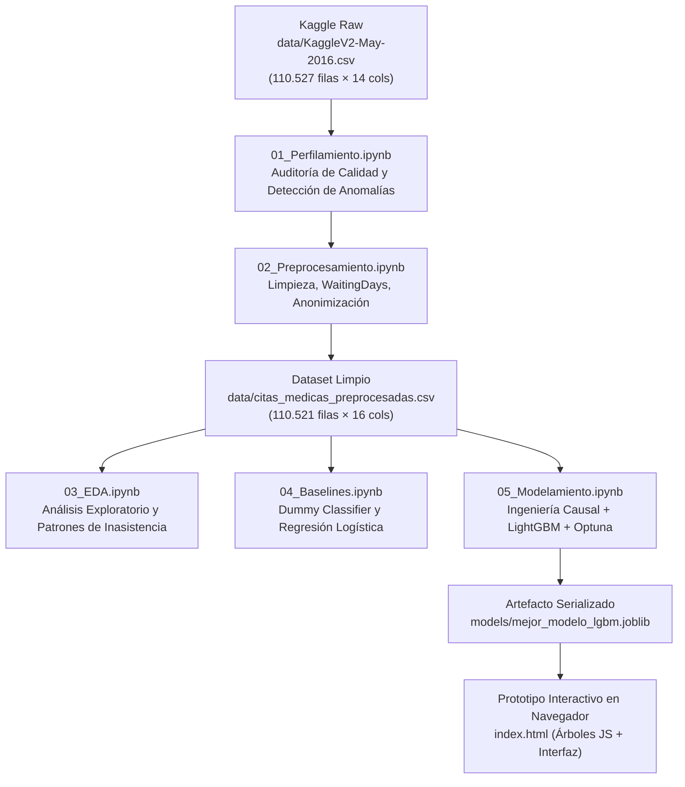

# Predicción de Inasistencias a Citas Médicas · Hospital Aurora

Prototipo integral de ciencia de datos y aprendizaje automático (*Machine Learning*) orientado a la gestión hospitalaria. El proyecto aborda la problemática de la inasistencia de pacientes a consultas programadas (*No-show*), abarcando desde la auditoría y depuración de datos crudos hasta el entrenamiento de un modelo **LightGBM** de alto rendimiento y su culminación en una **demostración interactiva autónoma en navegador ([index_prototipo.html](index_prototipo.html))**.

---

## 📌 Tabla de Contenidos

1. [Visión General del Proyecto](#-visión-general-del-proyecto)
2. [Problema de Negocio y Objetivos](#-problema-de-negocio-y-objetivos)
3. [Demostración Interactiva (`index.html`)](#-demostración-interactiva-indexhtml)
   - [Características del Prototipo](#características-del-prototipo)
   - [Guion de Demostración (3 Minutos)](#guion-de-demostración-3-minutos)
4. [Flujo de Trabajo y Pipeline de Datos](#-flujo-de-trabajo-y-pipeline-de-datos)
5. [Modelo Predictivo y Resultados](#-modelo-predictivo-y-resultados)
   - [Ingeniería de Características y Prevención de Fuga](#ingeniería-de-características-y-prevención-de-fuga)
   - [Validación Cruzada y Comparativa contra Baseline](#validación-cruzada-y-comparativa-contra-baseline)
   - [Umbrales de Decisión Operativos](#umbrales-de-decisión-operativos)
6. [Estructura del Repositorio](#-estructura-del-repositorio)
7. [Guía de Instalación y Reproducción](#-guía-de-instalación-y-reproducción)
8. [Documentación del Proyecto (`/docs`)](#-documentación-del-proyecto-docs)
9. [Supuestos, Ética y Limitaciones](#-supuestos-ética-y-limitaciones)
10. [Equipo](#-equipo)

---

## 🏥 Visión General del Proyecto

En los sistemas de salud públicos y ambulatorios, una proporción considerable de citas médicas agendadas se pierde debido a inasistencias no notificadas. Esto provoca subutilización de especialistas y pabellones, costos operacionales innecesarios, retraso de diagnósticos críticos y saturación de los servicios de urgencia.

Este proyecto desarrolla una solución analítica de extremo a extremo que:
1. **Audita y transforma** más de 110.000 citas médicas del dataset *Medical Appointment No Shows* (Kaggle).
2. **Entrena y optimiza** un modelo predictivo basado en Gradient Boosting (**LightGBM**, 1.050 árboles) calibrado para clasificar el riesgo de inasistencia mediante validación estricta por paciente (`GroupKFold`).
3. **Despliega un simulacro interactivo de gestión hospitalaria en un archivo único ([index_prototipo.html](index_prototipo.html))**, capaz de ejecutar el modelo completo en JavaScript del lado del cliente, calcular explicaciones locales tipo SHAP y simular escenarios "what-if" sin requerir servidores, backend ni conexión a internet.

---

## 🎯 Problema de Negocio y Objetivos

### El Reto Operativo
* **Etiqueta Objetivo:** `No-show` (`True` / `1` = el paciente **no asistió** a su cita).
* **Desbalance de Clases:** ~79.8% asistencias vs. **20.2% inasistencias**.
* **Impacto:** Pérdida de horas profesionales, medicamentos e insumos perecibles, y dilatación de listas de espera.

### Criterios de Éxito y KPIs (según [`docs/T02-problema_user_y_kpis.md`](docs/T02-problema_user_y_kpis.md))

| Categoría | KPI | Meta de Referencia | Estado del Modelo |
| :--- | :--- | :---: | :---: |
| **Desempeño** | **M1. Recall de inasistencias** | $\ge 0.65$ | **Cumple (0.6500 a 0.7401)** |
| **Priorización** | **M2. Lift@20 (Quintil superior)** | $\ge 1.50$ | **Cumple (2.0140)** |
| **Operación** | **O1. Cobertura de priorización** | $18\% - 22\%$ | Depende del umbral y de las citas de la demo |
| **Operación** | **O2. Entregabilidad SMS** | $\ge 95\%$ | Simulada; no mide entregas reales |
| **Gobernanza** | **G3. Intervención no destructiva** | **0 cancelaciones automáticas** | **Cumple (0)** |
| **Calidad** | **D1. Completitud de atributos** | $\ge 98\%$ | **Cumple (100%)** |

> [!IMPORTANT]
> **Human-in-the-Loop:** El modelo **nunca** cancela, rechaza ni reasigna citas automáticamente. Su única función es clasificar y ordenar las citas por riesgo para que el equipo clínico priorice llamadas de confirmación, recordatorios SMS personalizados o rescate de cupos.

---

## 💻 Demostración Interactiva (`index.html`)

El proyecto culmina en la interfaz interactiva autónoma contenida en **[index_prototipo.html](index_prototipo.html)**.

```
                  ┌──────────────────────────────────────────────┐
                  │          Hospital Aurora · Agenda            │
                  │   Turno Mañana · 20 de mayo de 2016          │
                  └──────────────────────┬───────────────────────┘
                                         │
                 ┌───────────────────────┴───────────────────────┐
                 ▼                                               ▼
     ┌────────────────────────┐                     ┌────────────────────────┐
     │  Scoring en Vivo JS    │                     │  Gestión y Contacto    │
     │  1.050 árboles LightGBM│                     │  Bitácora, SMS, Estado │
     └───────────┬────────────┘                     └───────────┬────────────┘
                 │                                               │
                 └───────────────────────┬───────────────────────┘
                                         │
                 ┌───────────────────────┴───────────────────────┐
                 ▼                                               ▼
     ┌────────────────────────┐                     ┌────────────────────────┐
     │  Explicabilidad (SHAP) │                     │  Simulación Hipotética │
     │  Aportes en log-odds   │                     │  Escenarios "What-If"  │
     └────────────────────────┘                     └────────────────────────┘
```

### Características del Prototipo
* **Zero-Cost & Zero-Dependencies:** No requiere instalar Node.js, Python, bases de datos ni servicios en la nube. Abre directamente con doble clic en navegadores modernos (Chrome, Edge, Firefox).
* **Inferencia Local en el Navegador:** Integra los **1.050 árboles de decisión** del modelo serializado (`mejor_modelo_lgbm.joblib`) directamente en código JavaScript optimizado, evaluando todas las ramificaciones y transformaciones numéricas/categóricas al instante.
* **Triage Clínico y Priorización:** Permite alternar entre orden cronológico y orden por puntaje de riesgo, filtrando citas que superan el umbral operativo.
* **Explicabilidad Transparente (XAI):** Muestra descomposiciones locales tipo SHAP para cada paciente en unidades log-odds, identificando qué factores aumentan o reducen la probabilidad predicha.
* **Simulación "What-If":** Permite al usuario manipular variables como días de anticipación de reserva para observar en tiempo real la variación en la probabilidad de asistencia.
* **Persistencia Local:** Las acciones registradas (llamadas, confirmaciones, notas de seguimiento) se guardan en `localStorage` del navegador.
* **Mensajería simulada:** Permite editar plantillas, simular los estados de entrega de Twilio, consultar intentos y reintentar. La entregabilidad O2 usa entregas confirmadas / intentos enviados. No envía SMS reales ni se conecta a Twilio.

### Guion de Demostración (3 Minutos)

1. **Presentación de la Agenda:** Abre [index_prototipo.html](index_prototipo.html) (presiona `F11` para pantalla completa). Se presenta la jornada del turno mañana (20 de mayo de 2016) con 12 pacientes simulados. Observa los tres indicadores superiores: total de citas, citas prioritarias sobre el umbral y pacientes contactados.
2. **Priorización y Gestión de Riesgo:**
   - Activa el filtro **Para revisión** y ordena por hora o por mayor riesgo.
   - Selecciona a la paciente **Clara Azevedo** (estimación de riesgo inicial ~57.4%).
   - Presiona **Simular SMS con Twilio**, elige **Entrega confirmada** y pulsa **Simular envío**. El comprobante muestra estados simulados y se incorpora al registro.
   - Cierra el comprobante, pulsa **Registrar contacto → Asistencia confirmada** y observa la actualización del indicador de contactos.
3. **Explicabilidad del Puntaje (SHAP):**
   - En la ficha de Clara, pulsa **Ver explicación** o entra en **Análisis del riesgo**.
   - Compara su probabilidad contra el umbral de corte.
   - En la sección *«¿Qué influyó más en su puntaje?»*, identifica las variables determinantes (tiempo de espera, inasistencias previas, etc.).
4. **Simulación de Escenarios ("What-If"):**
   - En la misma ventana de explicación, reduce la anticipación de la cita a 0 días (*same-day appointment*).
     - Observa el cambio en el puntaje predicho y la diferencia en puntos porcentuales. Es una comparación hipotética del modelo, no una medición del efecto causal de cambiar la espera.
5. **Selector de Criterio / Umbral:**
   - En la barra lateral o cabecera, conmuta el umbral de **Máximo F1 (0.2219)** a **Recall objetivo 65% (0.2508)**.
   - Observa cómo se recalculan las alertas de riesgo y las tarjetas de métricas históricas de validación cruzada.
6. **Reinicio del Simulacro:** Pulsa **Reiniciar simulacro** para vaciar la bitácora local y preparar otra presentación.

En **Mensajería SMS** se pueden simular entregas fallidas, reintentos y confirmaciones posteriores. Cada intento tiene su comprobante. La tasa mostrada es un indicador de la jornada ficticia y no acredita entregabilidad real. El [guion de la demo](docs/README-de-demo.md) explica la secuencia y sus indicadores.

---

## 🔄 Flujo de Trabajo y Pipeline de Datos

El desarrollo siguió un ciclo riguroso y reproducible a través de los notebooks del repositorio:



### Resumen de Fases Analíticas

* **`notebooks/01_Perfilamiento.ipynb`:** Evaluación de completitud (0 valores nulos, 0 filas duplicadas). Se identificaron una edad negativa, edades extremas de 115 años y cinco citas con fecha de agendamiento posterior a la atención. El notebook 02 excluye la edad negativa y las cinco citas con fechas incoherentes.
* **`notebooks/02_Preprocesamiento.ipynb`:** Normalización temporal, cálculo de días de anticipación (`WaitingDays = AppointmentDay - ScheduledDay`), depuración de registros incoherentes y anonimización de identificadores. Dataset resultante: **110.521 filas y 62.298 pacientes**.
* **`notebooks/03_EDA.ipynb`:** Descubrimiento de correlaciones determinantes:
  - Las citas agendadas para el mismo día (*same-day*) tienen una inasistencia de apenas ~4.6%, mientras que citas con más de 15 días de anticipación superan el 32%.
  - Fuerte reincidencia: pacientes con ausencias pasadas duplican la tasa de inasistencia promedio.
* **`notebooks/04_Baselines.ipynb`:** Modelos de referencia iniciales. Un clasificador *Dummy* obtiene 79.8% de exactitud pero 0% de recall. La regresión logística balanceada alcanza recall de 55.9% con baja precisión (31.6%).
* **`notebooks/05_Modelamiento.ipynb`:** Baseline LightGBM de 17 variables, historial por cita, selección de hiperparámetros, validaciones agrupada y temporal y exportación del modelo final. La búsqueda con Optuna está incluida y se activa de forma opcional.

---

## 🧠 Modelo Predictivo y Resultados

El modelo final es un **`LGBMClassifier`** entrenado con 38 características estructuradas, serializado en [`models/mejor_modelo_lgbm.joblib`](models/mejor_modelo_lgbm.joblib).

### Ingeniería de Características y Prevención de Fuga

El notebook 05 calcula el historial por paciente con las citas disponibles antes del día de atención. El suavizado usa la prevalencia del CSV completo, una limitación de esta versión.

1. **Historial Causal por Paciente (`agregar_historial_causal`):**
   - Mediante búsqueda binaria (`np.searchsorted` con `side='left'`), cada cita solo consulta citas del mismo paciente con fecha de atención estrictamente anterior.
   - `PriorVisits`: Citas previas del paciente.
   - `PriorNoShows`: Inasistencias previas.
   - `PriorNoShowRate`: Tasa histórica con **suavizado bayesiano empírico** ($\alpha = 20.0$), evitando distorsiones en pacientes con pocas atenciones:
     $$\text{PriorNoShowRate} = \frac{\text{PriorNoShows} + \alpha \cdot \text{TasaGlobal}}{\text{PriorVisits} + \alpha}$$
   - `HasHistory`, `DaysSinceLastVisit`, `LastVisitNoShow`.
2. **Variables Temporales y de Espera:** `WaitingDaysLog` ($\ln(1 + \text{WaitingDays})$), `IsSameDay`, `ScheduledHour`, `ScheduledDayOfWeek`, `AppointmentWeek`.
3. **Variables Clínicas y Sociodemográficas:** `AgeGroup`, `IsChild`, `IsSenior`, `ChronicAndSenior` (interacción de edad con comorbilidades), `HasHandcap`.

### Validación Cruzada y Comparativa contra Baseline

La evaluación se realizó mediante **`GroupKFold(5)` agrupado por `PatientId`**, garantizando que los pacientes evaluados en validación nunca formaron parte del entrenamiento.

| Métrica OOF | Baseline formal | Modelo final | Diferencia |
| --- | ---: | ---: | ---: |
| ROC-AUC | 0.7389 | 0.7535 | +0.0146 |
| PR-AUC (precisión promedio) | 0.3841 | 0.4103 | +0.0262 |
| F1 | 0.4499 | 0.4628 | +0.0129 |
| Recall | 0.7602 | 0.7401 | -0.0200 |
| Precisión | 0.3195 | 0.3366 | +0.0171 |
| Lift@20 | 1.9331 | 2.0140 | +0.0809 |
| Recall@20 | 0.3866 | 0.4028 | +0.0162 |

El baseline y el modelo final excluyen `PatientId` de sus entradas y eligen sus propios umbrales F1 sobre predicciones OOF. Para Lift@20 y Recall@20 se ordenan las citas por riesgo y se toman las primeras `round(0.20 × n)`, que aquí son 22.104.

#### Validación Temporal Secundaria (Backtesting `2016-05-25`)
La prueba reserva las citas posteriores al 25 de mayo de 2016.

| Métrica temporal | Baseline formal | Modelo final |
| --- | ---: | ---: |
| ROC-AUC | 0.7184 | 0.7303 |
| PR-AUC (precisión promedio) | 0.3189 | 0.3458 |
| Lift@20 | 1.7798 | 1.8876 |
| Recall@20 | 0.3560 | 0.3775 |

### Umbrales de Decisión Operativos

El modelo ofrece dos puntos de corte calibrados con predicciones fuera de pliegue (OOF):

1. **Umbral F1 Óptimo (`0.2219`):** Maximiza el balance de clasificación ($F_1 = 0.4628$, Recall = 74.01%, Precisión = 33.66%).
2. **Umbral Negocio / KPI M1 (`0.2508`):** Satisface la exigencia de $\text{Recall} \ge 65\%$ (**65.00%**) incrementando la precisión a **35.36%**. Es el umbral recomendado para centros de salud que disponen de capacidad limitada de llamadas telefónicas.

---

## 📁 Estructura del Repositorio

```text
prediccion-inasistencias/
│
├── index.html                               # Acceso al prototipo
├── index_prototipo.html                     # Demostración interactiva autónoma (1.050 árboles JS)
├── AGENTS.md                                # Instrucciones operativas para agentes y entorno
├── README.md                                # Documentación principal del proyecto
├── requirements.txt                         # Dependencias de Python fijadas
│
├── docs/                                    # Documentación técnica y de gestión del proyecto
│   ├── INFORME_GENERAL_PROYECTO.md          # Informe general de desarrollo, metodologías y cronograma
│   ├── T01-documento.md                     # Alcance, supuestos, riesgos, restricciones y Kanban
│   ├── T02-problema_user_y_kpis.md          # Definición de negocio, usuario y matriz de KPIs
│   ├── T03-diccionario-datos.md             # Diccionario y metadatos de variables crudas
│   ├── T04-calidad-datos.md                 # Informe de auditoría y perfilamiento de datos
│   ├── INFORME_MODELO_ML.md                 # Informe técnico exhaustivo de ingeniería y ML
│   └── README-de-demo.md                    # Documentación original del prototipo y guion
│
├── data/                                    # Repositorio de datos
│   ├── KaggleV2-May-2016.csv                # Dataset crudo original (110.527 filas)
│   └── citas_medicas_preprocesadas.csv      # Dataset limpio y depurado (110.521 filas)
│
├── models/                                  # Artefactos del modelo predictivo
│   ├── mejor_modelo_lgbm.joblib             # Modelo entrenado con 100% de datos (12.8 MB)
│   ├── metricas.json                        # Registro formal de métricas OOF y temporales
│   ├── mejores_hiperparametros.json         # Parámetros seleccionados por Optuna
│   └── README.md                            # Ficha técnica del modelo y código de inferencia
│
└── notebooks/                               # Cuadernos Jupyter secuenciales
    ├── 01_Perfilamiento.ipynb               # 01: Calidad inicial y tipificación
    ├── 02_Preprocesamiento.ipynb            # 02: Limpieza, filtros y exportación del CSV limpio
    ├── 03_EDA.ipynb                         # 03: Análisis exploratorio de datos
    ├── 04_Baselines.ipynb                   # 04: Modelos base de referencia
    └── 05_Modelamiento.ipynb                # 05: Pipeline de modelamiento, OOF y exportación
```

---

## 🚀 Guía de Instalación y Reproducción

### 1. Ejecutar la Demo Interactiva (Sin Instalación)
Para explorar la demostración de gestión hospitalaria:
1. Haz doble clic en **[index_prototipo.html](index_prototipo.html)** para abrirlo en cualquier navegador web moderno.
2. No requiere servidor local, conexión a internet ni dependencias adicionales.

### 2. Configuración del Entorno de Machine Learning (Python)
Para reentrenar modelos o ejecutar los notebooks analíticos:

```powershell
# Clonar o situarse en la raíz del repositorio
cd prediccion-inasistencias

# Crear y activar entorno virtual con Python 3.12
python -m venv .venv
.venv\Scripts\activate

# Instalar dependencias exactas
pip install -r requirements.txt
```

### 3. Reproducir los datos y el modelo

Ejecutar desde la raíz con Python 3.12. Con el entorno virtual instalado, ejecutar los cuadernos en orden usando la raíz del repositorio como directorio de trabajo.

```powershell
.venv\Scripts\python.exe -c "import nbformat,sys; from nbconvert.preprocessors import ExecutePreprocessor; nb=nbformat.read(sys.argv[1],4); ExecutePreprocessor(timeout=900,kernel_name='python3').preprocess(nb,{'metadata':{'path':'.'}})" notebooks/02_Preprocesamiento.ipynb
.venv\Scripts\python.exe -c "import nbformat,sys; from nbconvert.preprocessors import ExecutePreprocessor; nb=nbformat.read(sys.argv[1],4); ExecutePreprocessor(timeout=900,kernel_name='python3').preprocess(nb,{'metadata':{'path':'.'}})" notebooks/05_Modelamiento.ipynb
```

El cuaderno 02 regenera el CSV limpio. El 05 reutiliza `models/mejores_hiperparametros.json` y exporta el estimador y `models/metricas.json`. La configuración publicada usa 1.050 árboles, 118 hojas, profundidad 12 y tasa de aprendizaje 0.010458503793355878. La opción `EJECUTAR_OPTUNA` permite explorar hasta 40 ensayos con tres pliegues por paciente. Está desactivada en la reproducción.

---

## 📚 Documentación del Proyecto (`/docs`)

### Entrega consolidada del 23 de noviembre de 2026

- [Informe principal EP5/EP6 actualizado](output/pdf/Informe_Principal_EP5_EP6_Actualizado.pdf): ocho páginas con etapas, entregables, decisiones y contraste del plan con Jira.
- [Presentación para el cliente](output/presentacion/PPT_Gestion_EV3.PPTX): presentación de la defensa en diez diapositivas.
- [Registro actualizado de desviaciones](output/pdf/Registro_Control_Desviaciones_Actualizado.pdf): incidente T06/T07, respuesta, recuperación declarada y consolidación administrativa, sin horas de retraso.
- [Evidencias técnicas y de seguimiento](docs/evidencias/): capturas, métricas reproducidas y cortes de estado. Los enlaces a Jira requieren acceso al tablero.

Jira registra 14 de 15 tareas finalizadas. T13 sigue en curso porque los materiales están terminados y falta exponer. Las seis jornadas de seguimiento se documentan retrospectivamente; las fechas de ejecución declaradas se distinguen de las fechas automáticas del sistema.

El entrenamiento completo se reprodujo con Python 3.12.4 tras reparar la ruta del entorno local. Las métricas coincidieron con las vigentes con tolerancia absoluta de 1e-9; durante esa prueba se conservaron las huellas del modelo, las métricas y el HTML entonces vigente. El HTML fue reemplazado después por la versión EV3 de mensajería; su modelo integrado se conserva sin cambios. El [resultado histórico de reproducción](docs/evidencias/reproduccion_entrenamiento_2026-11-23.json) y las capturas con fecha del 23/nov corresponden a la versión anterior. Los PDF y la presentación de esa entrega también reflejan ese corte; para el recorrido y controles actuales, consultar el [guion EV3](docs/README-de-demo.md).

El 26 de noviembre se reprodujeron los dos notebooks y se contrastaron el estimador anterior, el actual y el prototipo. La comprobación incluye las predicciones de una muestra fija de 1.000 citas. [Evidencia de la refactorización](docs/evidencias/refactorizacion_notebooks_2026-11-26.json)

Toda la documentación técnica, estratégica y metodológica se encuentra centralizada en la carpeta [`docs/`](docs/):

* **[`docs/INFORME_GENERAL_PROYECTO.md`](docs/INFORME_GENERAL_PROYECTO.md):** Informe general de desarrollo, etapas, metodología, bitácora del sprint, contingencia del Día 4 y resultados.
* **[`docs/T01-documento.md`](docs/T01-documento.md):** Alcance, supuestos, matriz de riesgos (fuga de información, sesgos, transferencia de datos), restricciones operacionales y tablero Kanban del proyecto.
* **[`docs/T02-problema_user_y_kpis.md`](docs/T02-problema_user_y_kpis.md):** Caracterización del usuario, valor esperado y umbrales cuantitativos de KPIs (calidad, desempeño M1-M3, operación O1-O2, gobernanza G1-G4).
* **[`docs/T03-diccionario-datos.md`](docs/T03-diccionario-datos.md):** Ficha técnica de la fuente Kaggle y glosario de las 14 variables originales.
* **[`docs/T04-calidad-datos.md`](docs/T04-calidad-datos.md):** Reporte de auditoría de datos, tratamiento de edades atípicas y coherencia temporal de fechas.
* **[`docs/INFORME_MODELO_ML.md`](docs/INFORME_MODELO_ML.md):** Informe técnico completo del ciclo de vida del modelo ML, formulación matemática del suavizado bayesiano, curvas ROC/PR OOF e instrucciones de integración.
* **[`docs/README-de-demo.md`](docs/README-de-demo.md):** Guion y especificaciones de la demo EV3.

---

## ⚠️ Supuestos, Ética y Limitaciones

1. **Decisión Humana y No Cancelación:** El sistema es una herramienta de soporte a la decisión (*decision support system*). Bajo ningún motivo una predicción algorítmica debe derivar en la cancelación unilateral o reasignación de citas de un paciente.
2. **Contexto Geográfico de los Datos:** El dataset proviene de la red de salud pública de Vitória, Espírito Santo, Brasil (2016). Su aplicación en otros contextos (por ejemplo, el sistema de salud en Chile) constituye una prueba de concepto académica que requiere reentrenamiento y calibración con datos demográficos locales antes de un piloto clínico.
3. **Tratamiento de la Variable `SMS_received`:** El envío de SMS es una acción previa a la consulta. En escenarios donde el triage predictivo deba realizarse antes de programar recordatorios, el modelo debe evaluarse prescindiendo de dicha variable para evitar fugas de intervención.
4. **Predicción vs. Causalidad:** Un puntaje de alto riesgo (*scoring*) o un valor elevado de Lift@20 demuestran que el algoritmo concentra con éxito a los pacientes inasistentes; sin embargo, validar si el contacto telefónico reduce efectivamente la inasistencia requiere ensayos controlados aleatorizados (*A/B testing* en producción).

---

## 👥 Equipo

* **Alfredo Álvarez:** Ingeniería de datos, auditoría de calidad y perfilamiento exploratorio (EDA).
* **Diego Bustamante:** Modelamiento predictivo, optimización de hiperparámetros, validación cruzada y arquitectura de prototipo.
