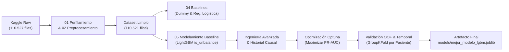

# Informe Técnico: Proceso de Creación, Optimización y Empaquetado del Modelo Predictivo de Inasistencias Médicas

**Proyecto:** Prototipo Predictivo de Inasistencias a Citas Médicas  
**Dataset Base:** Kaggle Medical Appointment No Shows (110.521 registros limpios)  
**Artefacto Resultante:** `models/mejor_modelo_lgbm.joblib`  
**Fecha:** Noviembre 2026  

---

## 1. Resumen Ejecutivo y Objetivos

El presente informe documenta detalladamente el ciclo de investigación, ingeniería de datos, modelamiento predictivo, optimización y validación cruzada que dio lugar al **modelo de Machine Learning vigente** del proyecto. 

El propósito principal es predecir la probabilidad de que un paciente agendado no asista a su cita médica (`No-show = True` / `1`, representativo del 20.2% de los eventos, clase minoritaria desbalanceada). Esta predicción alimenta un mecanismo de toma de decisiones hospitalarias cuyo fin es **priorizar el contacto oportuno y confirmación telefónica/SMS en el 20% de citas con mayor riesgo**, optimizando los recursos operativos del centro de salud sin incurrir en cancelaciones automáticas.



---

## 2. Antecedentes del Pipeline y Datos de Entrada

El proyecto sigue una secuencia modular reflejada en los notebooks del repositorio:

1. **`01_Perfilamiento.ipynb`:** Auditoría de calidad inicial sobre el dataset crudo (`data/KaggleV2-May-2016.csv`, 110.527 filas $\times$ 14 columnas). Se detectaron inconsistencias como edades negativas (-1) y registros anómalos.
2. **`02_Preprocesamiento.ipynb`:** Depuración de inconsistencias, tipificación correcta de variables temporales (`ScheduledDay`, `AppointmentDay`), cálculo de la brecha de espera (`WaitingDays = AppointmentDay - ScheduledDay`) y anonimización de pacientes. Generó el conjunto limpio de referencia: `data/citas_medicas_preprocesadas.csv` (**110.521 citas y 62.298 pacientes únicos**).
3. **`03_EDA.ipynb`:** Identificación de patrones determinantes:
   * **Tiempo de espera:** Citas agendadas para el mismo día (*same-day appointments*, `WaitingDays = 0`) tienen una tasa de inasistencia minúscula (~4.6%), mientras que citas con espera $\ge 15$ días superan el 32% de inasistencia.
   * **Compromiso del paciente:** Pacientes con ausencias previas reiteran su inasistencia con frecuencia superior al 45%.
   * **Geografía:** Variaciones significativas de inasistencia según el barrio de residencia (`Neighbourhood`).
4. **`04_Baselines.ipynb`:** Modelos de referencia iniciales (Dummy Classifier con exactitud del 79.81% y Recall 0.00%, y Regresión Logística balanceada con Recall 55.90% pero baja precisión de 31.58%).

---

## 3. Del Baseline Inicial al Modelo Mejorado

El baseline formal del [notebook 05](../notebooks/05_Modelamiento.ipynb) usa 14 variables numéricas y tres categóricas. Ajusta 300 árboles con tasa de aprendizaje 0.05, `is_unbalance=True` y semilla 42. `PatientId` identifica los cinco pliegues y se excluye de la matriz. CatBoost se exploró durante el desarrollo inicial.

### Limitaciones Identificadas en el Baseline
* **Omisión de la historia causal del paciente:** El modelo no consideraba si el paciente ya se había atendido antes o cuántas veces había faltado.
* **Distorsión por `is_unbalance=True`:** Forzar ponderaciones inversas de clases dentro de los algoritmos de árbol sesgó las probabilidades hacia arriba y comprimió las diferencias de riesgo relativo, reduciendo la efectividad del ranking (**Lift@20**).
* **Falta de granularidad temporal y clínica:** No se capturaba la estacionalidad semanal ni la acumulación de factores de riesgo en adultos mayores.

### Mejoras Introducidas en el Modelo Definitivo

#### A. Historial Causal Estricto (`agregar_historial_causal`)
Se diseñó un mecanismo de cálculo histórico por paciente que previene **fuga de información futura** (*data leakage*):
* Para cada cita, solo se observan las citas del mismo paciente con fecha de atención estrictamente anterior (`side='left'` mediante búsqueda binaria `np.searchsorted`).
* **Variables generadas:**
  * `PriorVisits`: Citas previas registradas.
  * `PriorNoShows`: Inasistencias previas acumuladas.
  * `PriorNoShowRate`: Tasa de inasistencia histórica con **suavizado bayesiano empírico** ($\alpha = 20.0$), que conserva la prevalencia del archivo completo. Es una limitación de la evaluación: validar el suavizado en otro período exige estimar esa prevalencia dentro del entrenamiento. La fórmula aplicada es
    $$\text{PriorNoShowRate} = \frac{\text{PriorNoShows} + \alpha \cdot \text{TasaGlobal}}{\text{PriorVisits} + \alpha}$$
  * `HasHistory`: Indicador booleano de si el paciente cuenta con historial previo.
  * `DaysSinceLastVisit`: Días transcurridos desde la última cita.
  * `LastVisitNoShow`: Si faltó a su última cita inmediata.

#### B. Variables Temporales y Clínicas Avanzadas (`construir_features`)
* `ScheduledDayOfWeek`, `ScheduledHour`, `ScheduledMonth`, `ScheduledDayOfMonth`: Momento del agendamiento.
* `AppointmentWeek`, `AppointmentDayOfMonth`, `AppointmentMonth`: Estacionalidad de la atención.
* `DaysSinceStart`: Días transcurridos desde el inicio del dataset (tendencia temporal).
* `IsSameDay`: Indicador de cita en el mismo día (`WaitingDays == 0`).
* `WaitingDaysLog`: Transformación logarítmica $\ln(1 + \text{WaitingDays})$.
* `HasHandcap`, `IsChild` ($<18$), `IsSenior` ($\ge 60$), `AgeGroup`, `ChronicAndSenior` (`IsSenior` $\times$ `Num_Conditions`).

#### C. Optimización de Hiperparámetros con Optuna
* **Objetivo de búsqueda:** Maximizar **PR-AUC (Precision-Recall AUC / Average Precision)** sobre un esquema `GroupKFold(3)` por `PatientId`.
La búsqueda opcional usa un muestreador TPE con semilla 42, hasta 40 ensayos y un presupuesto de 600 segundos. La reproducción carga los valores seleccionados y ajusta el clasificador final sin ponderación de clases.

| Hiperparámetro | Valor publicado |
| --- | ---: |
| `n_estimators` | `1050` |
| `learning_rate` | `0.010458503793355878` |
| `num_leaves` | `118` |
| `max_depth` | `12` |
| `min_child_samples` | `42` |
| `subsample` | `0.9039510403749871` |
| `colsample_bytree` | `0.5637759170174783` |
| `reg_alpha` | `0.1247455263698487` |
| `reg_lambda` | `0.004080079613243916` |
| `min_split_gain` | `0.037248937387822256` |
| `subsample_freq` | `1` |
| `is_unbalance` | `False` |
| `random_state` | `42` |
| `verbose` | `-1` |
| `n_jobs` | `8` |

---

## 4. Metodología de Validación y Resultados Comparativos

### Protocolo Principal: `GroupKFold(5)` por `PatientId`
Para garantizar que el modelo sea evaluado en condiciones idénticas a la realidad (donde ingresan pacientes completamente nuevos al centro de salud), el agrupamiento se realizó por `PatientId`. Las predicciones se calcularon **fuera de pliegue (Out-Of-Fold, OOF)** sobre las 110.521 observaciones.

### Tabla Comparativa: Baseline vs. Modelo Mejorado (OOF)

| Métrica OOF | Baseline formal | Modelo final | Diferencia |
| --- | ---: | ---: | ---: |
| ROC-AUC | 0.7389 | 0.7535 | +0.0146 |
| PR-AUC (precisión promedio) | 0.3841 | 0.4103 | +0.0262 |
| F1 | 0.4499 | 0.4628 | +0.0129 |
| Recall | 0.7602 | 0.7401 | -0.0200 |
| Precisión | 0.3195 | 0.3366 | +0.0171 |
| Lift@20 | 1.9331 | 2.0140 | +0.0809 |
| Recall@20 | 0.3866 | 0.4028 | +0.0162 |

La diferencia se calcula sobre valores completos. Para ambos estimadores, el F1 usa el máximo de su propia curva de precisión y recall OOF. El tamaño del grupo para Lift@20 se redondea al entero más cercano, 22.104 de 110.521 citas.

> Nota metodológica: La última celda del notebook 05 original mostraba un ROC-AUC de 0.8170 y PR-AUC de 0.5123; esos valores estaban calculados sobre el conjunto de entrenamiento (sobreajuste). El rendimiento generalizable real ante pacientes no vistos es **ROC-AUC 0.7535** y **PR-AUC 0.4103**.

---

### Validación Temporal Secundaria (Backtesting hacia el Futuro)
Para simular el despliegue en producción (entrenar con citas pasadas y predecir citas futuras), se ejecutó una partición temporal con fecha de corte en **`2016-05-25`**:
* **Entrenamiento:** 75.278 citas (hasta el 25 de mayo).
* **Prueba Futura:** 35.243 citas (posteriores al 25 de mayo).

| Métrica temporal | Baseline formal | Modelo final |
| --- | ---: | ---: |
| ROC-AUC | 0.7184 | 0.7303 |
| PR-AUC (precisión promedio) | 0.3189 | 0.3458 |
| Lift@20 | 1.7798 | 1.8876 |
| Recall@20 | 0.3560 | 0.3775 |

El modelo mejorado mantiene su superioridad predictiva y estabilidad ante el transcurso del tiempo.

---

## 5. Cumplimiento de KPIs de Negocio (Documento T02)

En el documento normativo [`T02-problema_user_y_kpis.md`](T02-problema_user_y_kpis.md) se establecieron las metas clave para el modelo:

| KPI | Meta de Referencia | Resultado Modelo Mejorado | Estado | Análisis Operativo |
| :--- | :---: | :---: | :---: | :--- |
| **M1. Recall de inasistencia** | $\ge 0.65$ (65%) | **0.6500** (umbral `0.2508`) / **0.7401** (umbral `0.2219`) | **CUMPLE** | Con el umbral operativo `0.2508`, la precisión se eleva a **35.36%** (frente a 34.03% del baseline), optimizando horas de llamada telefónica. |
| **M2. Lift@20** | $\ge 1.50$ | **2.0140** | **CUMPLE** | Supera holgadamente el mínimo de 1.50. Concentra el doble de inasistencias en el quintil superior. |
| **G3. Intervención no destructiva** | 0 cancelaciones automáticas | **0 cancelaciones** | **CUMPLE** | El score predictivo se restringe exclusivamente a priorizar contactos de confirmación humana y recordatorios. |

---

## 6. Especificación del Artefacto Serializado

El modelo se encuentra entrenado sobre el 100% del dataset preprocesado y almacenado de forma reproducible:

* **Nombre de archivo:** `mejor_modelo_lgbm.joblib`
* **Ruta en el repositorio:** [`models/mejor_modelo_lgbm.joblib`](../models/mejor_modelo_lgbm.joblib)
* **Tamaño:** 12.84 MB
* **Formato:** Diccionario serializado con `joblib` conteniendo metadatos y modelos.

### Estructura del archivo de inferencia

`model` contiene el estimador. `features`, `numeric_features`, `categorical_features` y `categorical_categories` describen el orden y los valores admitidos. `target` y `positive_class` identifican la salida. `feature_defaults`, `history_mode` y `global_no_show_rate` definen el tratamiento del historial.

`threshold` y `threshold_recall_065` almacenan los cortes exactos. `thresholds` incluye su precisión, recall y F1. `metrics_oof`, `baseline_oof` y `temporal` coinciden con sus secciones en `metricas.json`. El registro incluye `training_rows`, `training_patients`, `trained_at`, `params`, `lightgbm_version` y `nota`. [Ficha de inferencia](../models/README.md)

> **Consistencia Categórica en Inferencia:** El diccionario incluye `categorical_categories`. Al predecir nuevas citas (por ejemplo, en un prototipo donde el usuario selecciona un único barrio), es mandatorio aplicar `pd.Categorical(df[col], categories=payload['categorical_categories'][col])` para evitar que pandas reasigne códigos numéricos erróneos a los árboles de decisión.

---

## 7. Inferencia desde Python y en el prototipo

La demo ejecuta los árboles en JavaScript. Una integración Python puede calcular la misma probabilidad con el estimador serializado.

```python
from pathlib import Path
import joblib
import pandas as pd

# 1. Cargar artefacto
RUTA_MODELO = Path("models") / "mejor_modelo_lgbm.joblib"
payload = joblib.load(RUTA_MODELO)
modelo = payload["model"]
features = payload["features"]
categoricas = payload["categorical_features"]
umbral_operativo = payload["threshold_recall_065"]  # 0.2508 (KPI Recall >= 0.65)

# 2. Formatear datos de entrada (fila única o lote)
def preparar_entrada(df_input: pd.DataFrame) -> pd.DataFrame:
    X = df_input[features].copy()
    for col in categoricas:
        X[col] = pd.Categorical(
            X[col], categories=payload["categorical_categories"][col]
        )
    return X

# 3. Predicción de riesgo y acción recomendada
X_nuevo = preparar_entrada(cita_nueva_df)
probabilidad = modelo.predict_proba(X_nuevo)[0, 1]
priorizar_contacto = bool(probabilidad >= umbral_operativo)

print(f"Probabilidad de Inasistencia: {probabilidad:.2%}")
print(f"Priorizar para contacto telefónico preventivo: {priorizar_contacto}")
```

### Valores por Defecto para Pacientes Nuevos en el Prototipo
Si un usuario ingresa una cita para un paciente nuevo sin antecedentes clínicos en el sistema:
* `PriorVisits`: `0`
* `PriorNoShows`: `0`
* `PriorNoShowRate`: `payload["global_no_show_rate"]` (prevalencia de entrenamiento)
* `HasHistory`: `0`
* `DaysSinceLastVisit`: `np.nan`
* `LastVisitNoShow`: `np.nan`

---

## 8. Reproducción y evidencia

El 26 de noviembre de 2026 el notebook 02 regeneró el CSV limpio y el notebook 05 se ejecutó desde un kernel nuevo. La comparación con el artefacto previo verificó los 1.050 árboles, el esquema categórico y 1.000 predicciones. Los PDF y la presentación del 23 de noviembre documentan la entrega académica de esa fecha. [Verificación de la refactorización](evidencias/refactorizacion_notebooks_2026-11-26.json)

Consultar los comandos de ejecución desde la raíz en la [guía de reproducción](../README.md).
