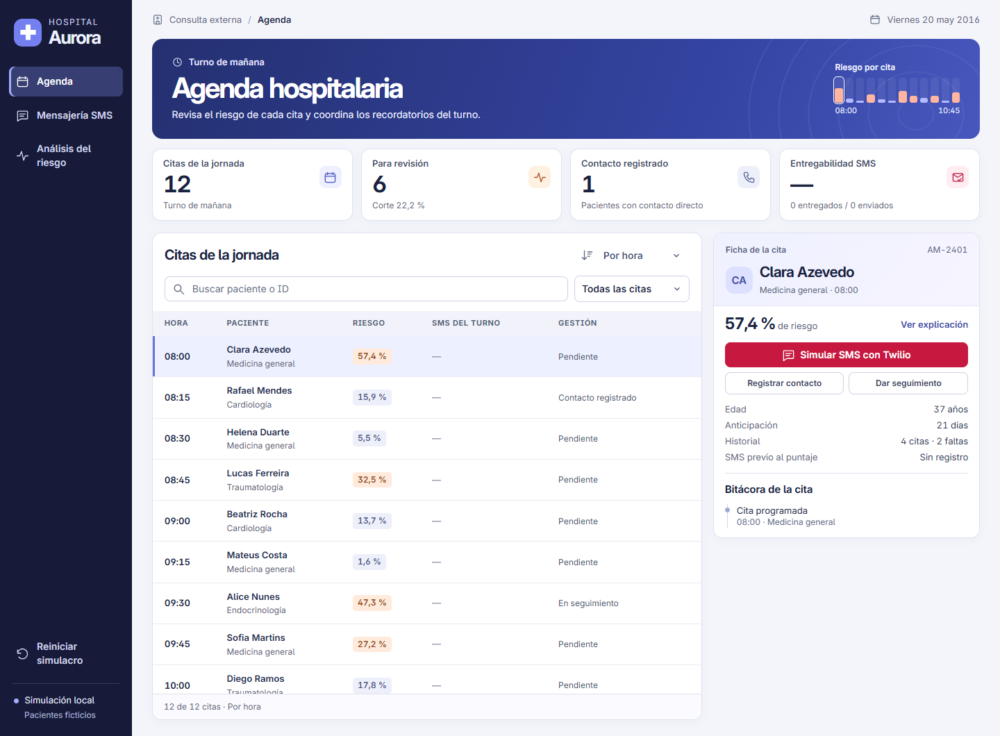
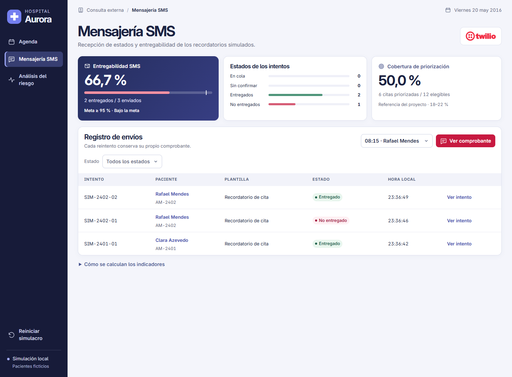

# Hospital Aurora · Agenda y mensajería SMS

Abre **[index_prototipo.html](../index_prototipo.html)** para presentar o compartir la demo sin conexión. El archivo contiene el modelo y los recursos visuales. Desde la raíz del repositorio, `index.html` también abre el prototipo. En Windows, presiona **F11** para proyectar.

## Guion para presentar el circuito SMS

1. En **Agenda**, abre la ficha de **Clara Azevedo**. El modelo estima un riesgo de inasistencia del 57,4 %. Puedes buscar una cita, seleccionar una barra de «Riesgo por cita» u ordenar la lista por hora, riesgo o nombre.
2. Pulsa **Simular SMS con Twilio**. Elige una plantilla, edita el texto y observa la vista previa. Selecciona **Entrega confirmada** y pulsa **Simular envío**. El comprobante avanza de «En cola» a «Enviado» y luego a «Entregado».
3. Abre **Ver registro de envíos**. Tras completar el primer intento verás **1 entregado / 1 enviado = 100 %**. La bitácora de Clara también incluye el comprobante.
4. En **Mensajería SMS**, elige una segunda cita, prepara otro SMS y selecciona **No entregado**. Al terminar, el indicador muestra **1 / 2 = 50 %**. En el comprobante pulsa **Reintentar SMS** y simula una entrega confirmada. La jornada acumulará **2 / 3 = 66,7 %**. Cada intento tiene un identificador propio.
5. Para demostrar una confirmación tardía, usa otra cita y selecciona **Sin confirmación de entrega**. Una vez enviado, puedes cerrar y volver al comprobante. **Confirmar entrega** o **Marcar no entregado** actualiza el mismo intento.
6. Usa **Reiniciar simulacro** para preparar la próxima exposición. Si el navegador permite almacenamiento local, conserva la bitácora y el criterio de priorización entre aperturas.

## Cómo interpretar los indicadores

| Indicador | Cálculo en la demo | Referencia del proyecto |
| --- | --- | --- |
| Entregabilidad SMS (O2) | Intentos con entrega confirmada / intentos que alcanzaron «Enviado» | Cumple a partir del 95 %. Alerta desde el 90 % hasta menos del 95 %. |
| Cobertura de priorización (O1) | Citas cuyo puntaje alcanza el umbral activo / 12 citas elegibles | Entre 18 % y 22 % |
| Contacto registrado | Pacientes distintos con una conversación registrada por el equipo | Conteo operativo de la jornada |

Un intento en cola todavía no entra en el denominador de O2. Un envío pendiente de confirmación o con resultado «No entregado» sí entra. Si aún hay informes pendientes, el indicador es provisional. Antes del primer envío aparece un guion. Los datos de «SMS previo al puntaje» corresponden a la situación original de la cita y se usan en el modelo. Los intentos del turno pertenecen a la bitácora de gestión.

Estos valores ilustran el flujo mediante escenarios elegidos por quien presenta. La demo simula localmente los estados de Twilio Messaging con destinatarios ficticios. El envío real, la facturación de SMS y los informes de un operador requieren una integración de servidor independiente.

## Cómo presentar el modelo

Abre **Ver explicación** desde la ficha o entra en **Análisis del riesgo**. La vista permite comparar el puntaje original con escenarios de anticipación e historial. Los aportes SHAP explican los tres grupos de variables de mayor magnitud en el caso original. Los botones de mensajería permiten gestionar esa cita manteniendo su predicción original como referencia.

El prototipo usa el modelo LightGBM exportado por el equipo, con 1.050 árboles y 38 variables. Las categorías, los perfiles y sus aportes proceden del prototipo EV3. Las métricas de clasificación y los dos umbrales se consultan en la validación fuera de pliegue del notebook 05, con cinco pliegues agrupados por paciente sobre Kaggle Brasil 2016. El criterio M1 prioriza las citas cuyo puntaje alcanza el umbral con mayor precisión entre los que cumplen recall ≥ 65 %. Los contadores operativos se calculan con la jornada ficticia del 20 de mayo. Las horas de registro de los mensajes usan el reloj local del dispositivo.

La prueba funcional de EV3 documenta el circuito SMS en la versión que se recibió originalmente. La comprobación posterior registra la correspondencia entre el modelo, las métricas y el HTML de esta entrega. [Prueba de EV3](evidencias/verificacion_dashboard_ev3.json) · [Verificación de los notebooks](evidencias/refactorizacion_notebooks_2026-11-26.json)

## Identidad visual

El logotipo de Twilio se incluye desde el recurso oficial de la marca. [Twilio](https://www.twilio.com/content/dam/twilio-com/core-assets/customer-logos/t-z/twilio.svg)

La fuente Inter se distribuye bajo la licencia SIL Open Font License, incluida en el HTML.
